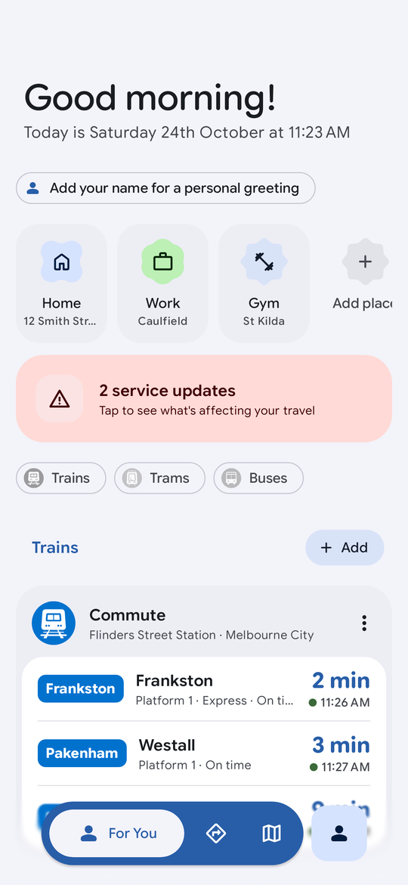
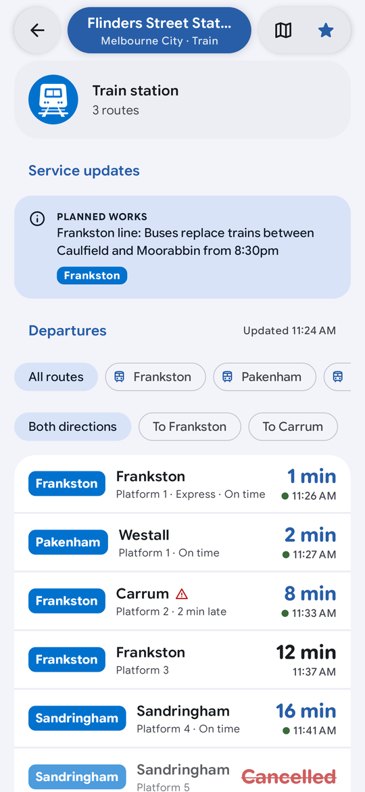
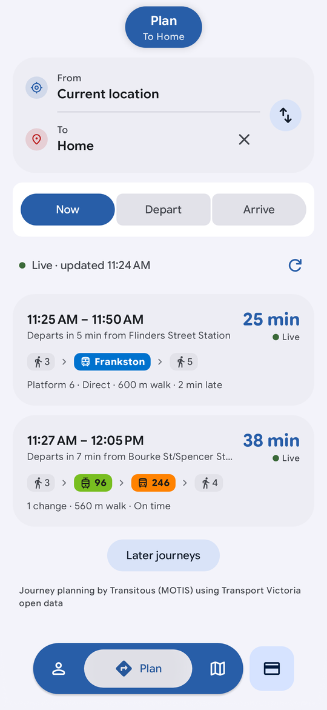
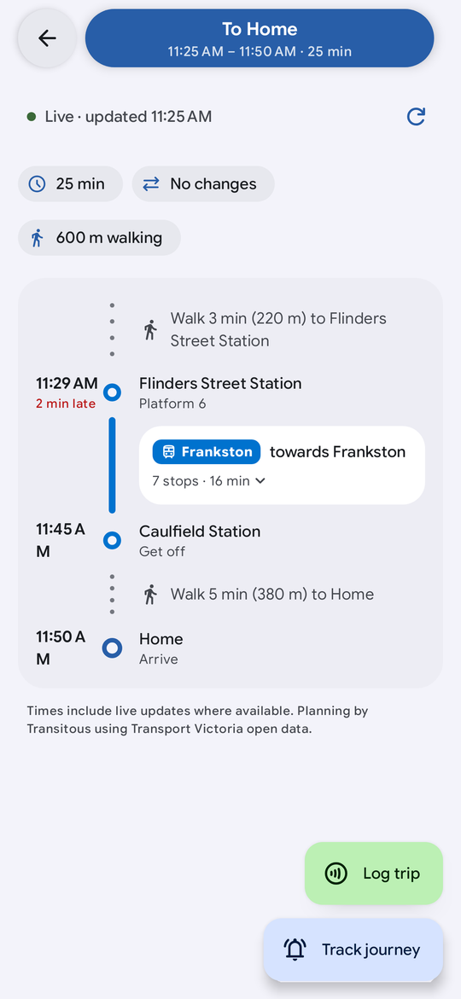
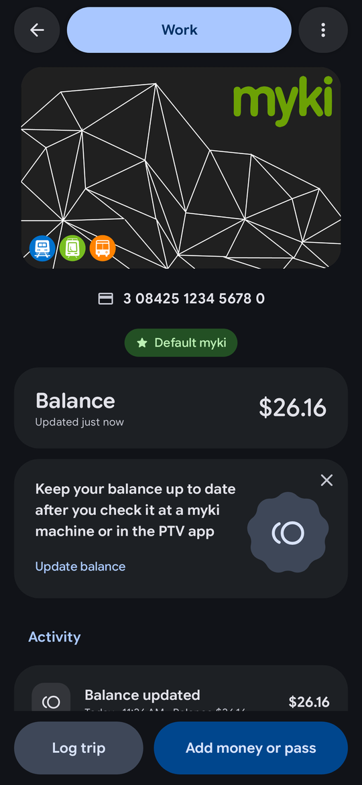
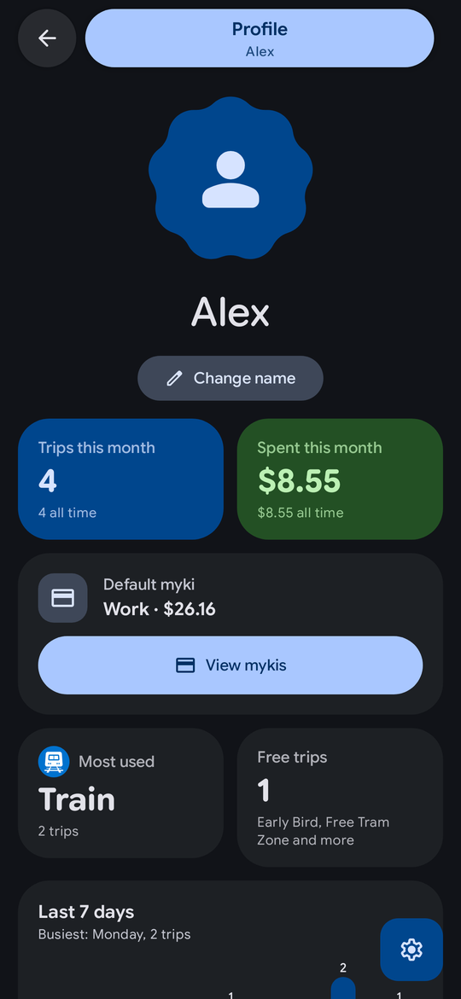

<div align="center">

# Journey

**A Material 3 Expressive replacement for the PTV app.**<br>
Live departures, journey planning, a live map, myki balance and trip tracking for Melbourne and Victoria.

[](LICENSE)
-3DDC84?logo=android&logoColor=white)


[](CONTRIBUTING.md)

</div>

> [!IMPORTANT]
> Journey is an **unofficial, independent** project. It is not affiliated with or endorsed by Public Transport
> Victoria, Transport Victoria, the Victorian Government, Mapbox or Transitous. "myki" and the PTV pictograms
> belong to their owners. See [THIRD_PARTY_NOTICES.md](THIRD_PARTY_NOTICES.md).

<p align="center">
  
  
  
  
  
  
</p>
<p align="center"><sub>Rendered by the test suite with fake data, so no real addresses or accounts appear.</sub></p>

## Contents

- [Features](#features)
- [Requirements](#requirements)
- [Getting started](#getting-started)
- [API keys (bring your own)](#api-keys-bring-your-own)
- [Building and testing](#building-and-testing)
- [Project structure](#project-structure)
- [How it works](#how-it-works)
- [Privacy](#privacy)
- [Known limitations](#known-limitations)
- [Contributing](#contributing)
- [Credits and licence](#credits-and-licence)

## Features

### 🏠 For You
- A greeting with today's date, then your favourite stops with **live departures** grouped by mode (trains, trams, buses).
- Saved places (Home, Work and your own) one tap away from planning a trip.
- Network status at a glance, mode filters, pull to refresh and auto refresh.
- A **Profile** with stats from the trips you log, and an avatar that morphs between Material 3 Expressive shapes.

### 🧭 Plan
- Door-to-door journeys from your current location (or any place) to anywhere, depart now or at a time you choose.
- **Live updates:** journeys re-plan in the background so delays show as they happen.
- Journey detail with a route map, walking legs, platforms and delays.
- **Track a journey or a single service:** a live notification (Android 16 live updates style) and an in-app banner.

### 🗺️ Map
- Full-screen edge-to-edge Mapbox map of stops for every mode, a stop preview and a floating *Nearby* panel.
- Search stops, routes and lines.

### 🚆 Live vehicle tracking
- Open any service to see a **map with its route, stops and the vehicle moving in real time**.
- A live status card ("Between Alphington and Fairfield") with the **scheduled and predicted time**, and a stop list shortened around you and the vehicle, with the vehicle's icon on the line.

### 💳 myki
- Keep your mykis in a wallet-style stack, with a **default myki**. Hold a card to your phone to read its number over **NFC** (experimental, you can always type it).
- **Log trips** from Plan or from a myki's page, or deduct a custom amount. Fares come from a built-in fare engine: the 2-hour fare, daily and weekend caps, Zone 2, the Free Tram Zone, concession, child and seniors fares.
- **Pricing that adapts:** discounts such as half-price or free travel are rules with date ranges you can switch on, edit or add, and prices are editable when they change.
- **Low-balance notifications** when a card drops below an amount you choose.

### 🧩 More
- **Home screen widget** (Jetpack Glance): favourites with live times, a refresh button and a last-updated time, responsive to its size.
- **[Essentials](https://github.com/sameerasw/essentials) island provider:** live tracking and a disruptions alert (coloured by severity) on the Dynamic Island-style overlay.
- **Design:** Material 3 Expressive, dynamic colour, a floating navigation bar and top pill with progressive blur, Material Symbols Rounded, optional pitch-black dark theme and haptics.

## Requirements

| | |
|---|---|
| **Device** | Android 8.0+ (API 26). Android 13+ for the blur effect, Android 16 for live-update notifications, an NFC phone to scan mykis. |
| **Android Studio** | A recent stable release that supports Android Gradle Plugin 9.4. |
| **JDK** | 25. Gradle downloads a matching toolchain for you through the Foojay resolver. |
| **Android SDK** | Platform **37.1** (compile SDK 37, minor API level 1) and build tools. Android Studio's SDK Manager installs them. |
| **Keys** | A free PTV Timetable API key and a Mapbox public token. See [below](#api-keys-bring-your-own). |

## Getting started

```bash
# 1. Clone
git clone https://github.com/ssethhyy/Journey.git
cd Journey

# 2. Add your keys (see the next section). local.properties is git-ignored.
cp local.properties.example local.properties
#    ...then edit local.properties

# 3. Build and install on a connected device or emulator
./gradlew :app:installDebug          # Windows: gradlew.bat :app:installDebug
```

Or open the folder in Android Studio, let Gradle sync, and press **Run**.

> [!TIP]
> The app builds and the whole test suite runs **without any keys**. Without them you simply get "missing
> credentials" messages instead of live data, and the map shows a placeholder.

## API keys (bring your own)

This repository contains **no keys**. Journey needs two free credentials, and you supply your own:

| Credential | Used for | Where to get it | Cost |
|---|---|---|---|
| `ptv.devId` and `ptv.apiKey` | Live departures, stops, routes, disruptions, fare zones, vehicle positions | Request a key from Public Transport Victoria on the [PTV Timetable API page](https://www.ptv.vic.gov.au/footer/data-and-reporting/datasets/ptv-timetable-api/). They email you a **developer ID** and an **API key**. | Free |
| `mapbox.accessToken` | The map tab, trip map and journey map | Create a **public** token (starts with `pk.`) at [account.mapbox.com](https://account.mapbox.com/access-tokens/) | Free tier |

Journey's journey planner uses [Transitous](https://transitous.org), which needs **no key**.

### Option 1: `local.properties` (recommended for development)

Copy [`local.properties.example`](local.properties.example) to `local.properties` in the project root and fill it in:

```properties
ptv.devId=1234567
ptv.apiKey=xxxxxxxx-xxxx-xxxx-xxxx-xxxxxxxxxxxx
mapbox.accessToken=pk.xxxxxxxx
```

Gradle reads this file at build time and bakes the values into the app **you build on your machine**. The file is
listed in [`.gitignore`](.gitignore), so it is never committed.

### Option 2: inside the app

Open **Profile → Settings → API access** and paste your developer ID, API key and Mapbox token. They are stored
privately on the device and override the build-time values. This is handy when you install an APK built by
someone else, or for trying different keys without rebuilding.

> [!WARNING]
> **Keep your keys out of Git.**
> - Never paste real keys into source files, issues, pull requests, screenshots or logs.
> - Use a **public** Mapbox token (`pk.`), never a secret one (`sk.`).
> - Keys built into an APK can be extracted by anyone who has that APK, so **do not publish or share APKs built with
>   your own keys**. Share the source and let people use their own.
> - If a key is ever committed or leaked, **revoke it and create a new one** straight away. Removing it from a later
>   commit does not remove it from history. See [SECURITY.md](SECURITY.md).
> - Turn on GitHub's *secret scanning* and *push protection* for your fork (Settings → Code security).

## Building and testing

```bash
./gradlew :app:assembleDebug            # debug APK  -> app/build/outputs/apk/debug/
./gradlew :app:installDebug             # build and install
./gradlew :app:testDebugUnitTest        # all unit and UI tests (no keys or network needed)
./gradlew :app:assembleRelease          # optimised release APK (signed with the debug key, see below)
```

- Tests use [Robolectric](https://robolectric.org) with native graphics and a local mock server, so they are
  deterministic and need no device. Screenshot tests write PNGs to `app/build/screenshots/`.
- The release build is **signed with the debug key** so it installs locally for testing. Replace the signing config
  in `app/build.gradle.kts` with your own (kept out of Git) before publishing anything.
- Release builds keep their icons through [`app/src/main/res/raw/keep.xml`](app/src/main/res/raw/keep.xml). Do not
  remove it: Material Symbols are loaded by name, which the resource shrinker can't see.

<details>
<summary><b>Troubleshooting</b></summary>

| Problem | Fix |
|---|---|
| `SDK location not found` | Open the project in Android Studio, or set `sdk.dir` in `local.properties`, or export `ANDROID_HOME`. |
| `Failed to find target with hash string 'android-37.1'` | Install *Android 37.1* in SDK Manager → SDK Platforms (tick *Show Package Details*). |
| Gradle can't find JDK 25 | Let the Foojay toolchain resolver download it, or install a JDK 25 and point `JAVA_HOME` at it. |
| The map tab says *Map needs a Mapbox token* | Add a public `pk.` token (see above) and rebuild, or paste it in Settings → API access. |
| Departures show a credentials or *403* error | Check the developer ID and API key. They are a pair, and the key must be copied exactly. |
| Dates and times look an hour off | Journey shows Melbourne time. Check your device's time zone setting if you're elsewhere. |
</details>

## Project structure

```text
Journey/
├── app/                           The Android app (single module)
│   └── src/main/java/com/ssethhyy/journey/
│       ├── data/
│       │   ├── api/               PTV Timetable API client (HMAC-signed), DTOs and mappers
│       │   ├── fare/              Fare engine, fare table and discount rules
│       │   ├── location/          Location provider
│       │   ├── model/             Domain models (stops, departures, patterns, trip progress)
│       │   ├── myki/              Cards, trip ledger, NFC reader, low-balance alerts, profile stats
│       │   ├── planner/           Journey planner (Transitous / MOTIS) client and models
│       │   └── repository/        Settings, favourites, places and PTV repositories
│       ├── island/                Essentials island provider (payloads, icons, expanded views)
│       ├── tracking/              Live tracking manager and foreground service
│       ├── ui/
│       │   ├── components/        Floating bars, timeline, symbols, progressive blur
│       │   ├── navigation/        Navigation 3 keys and the navigator
│       │   ├── screens/           For You, Plan, Map, stop, trip, myki, profile, settings...
│       │   └── theme/             Material 3 Expressive theme, typography, mode colours
│       ├── widget/                Glance home-screen widget
│       └── utils/                 Formatters, haptics, geo maths
├── third_party/essentials-island/ Vendored Essentials Island SDK (MIT, unmodified)
├── art/                           Source art: pictograms, launcher icon, icon and card guides
├── docs/                          Architecture notes and screenshots
├── .github/                       Issue and PR templates, CI, Dependabot
├── local.properties.example       Template for your own keys
└── gradle/libs.versions.toml      Dependency versions
```

## How it works

Journey is a single-activity Jetpack Compose app. A small hand-written dependency container (`AppContainer`)
wires repositories to screens, screens read state from `ViewModel`s exposed as `StateFlow`s, and everything is
stored on the device with DataStore. Departures, stops and vehicle positions come from the **PTV Timetable API**,
journeys from **Transitous**, and maps from **Mapbox**.

The [architecture guide](docs/ARCHITECTURE.md) covers the layers, the fare engine, live tracking, the island
provider and the testing approach in more detail.

## Privacy

- **No account, no analytics, no ads, no trackers.**
- Your favourites, places, mykis, trips and settings stay **on your device**.
- The app talks only to PTV (departures), Transitous (journeys) and Mapbox (map tiles). Your location is used on
  the device for *nearby* and planning, and sent to those services only as the coordinates of the request.
- Journey reads a myki's **card number** over NFC. A myki's balance and trips are locked on the card, so balances
  are entered by you and updated by the trips you log.

## Known limitations

- **NFC card scanning is experimental.** It reads only the card number and hasn't been verified against every card, so typing the number always works.
- **myki balances can't be read from the card** (they're encrypted and the keys aren't public). Balances are
  entered by hand and adjusted as you log trips, so they can drift from the real balance.
- **Fares are calculated by Journey**, from prices entered by hand. Check them in *Settings → Fares and discounts*
  after each 1 January. The weekly cap and regional **V/Line** fares aren't modelled (V/Line asks for an amount).
  Public holidays are a hand-kept list for 2026 and 2027.
- A trip between two Zone 2 stops that passes through Zone 1 is charged as Zone 2 unless you change the zone.
- Journey is a client for third-party services, so it depends on their availability and terms.

## Contributing

Contributions of all kinds are welcome: bug reports, fixes, features, fare updates, translations of the docs, design
feedback and tests. Please read **[CONTRIBUTING.md](CONTRIBUTING.md)** first. It covers the workflow, code and design
guidelines, and what a good pull request looks like. A quick version:

1. **Fork** the repo and create a branch (`feat/my-change` or `fix/my-bug`).
2. Add **your own keys** to `local.properties` and make sure `./gradlew :app:testDebugUnitTest` passes.
3. Make a focused change with tests, following the [guidelines](CONTRIBUTING.md#code-and-design-guidelines).
4. Open a **pull request** using the template, with screenshots for any UI change.

Found a security problem or leaked a key by accident? See [SECURITY.md](SECURITY.md). Everyone taking part is
expected to follow the [Code of Conduct](CODE_OF_CONDUCT.md).

## Credits and licence

Journey is released under the **[MIT License](LICENSE)**.

Built with and thanks to:
- [Essentials](https://github.com/sameerasw/essentials) and [android-common](https://github.com/sameerasw/android-common) by sameerasw, for the island SDK and the design-language reference the UI follows.
- [Material Symbols](https://fonts.google.com/icons) and Material 3 Expressive by Google.
- [Transitous](https://transitous.org) and [MOTIS](https://github.com/motis-project/motis) for open journey planning.
- Public Transport Victoria and Transport Victoria for open data, and [Mapbox](https://www.mapbox.com) with
  [OpenStreetMap](https://www.openstreetmap.org/copyright) contributors for maps.
- [Metrodroid](https://github.com/metrodroid/metrodroid) for documenting how the myki card number is stored.

The full list of third-party code, data and brand notices is in **[THIRD_PARTY_NOTICES.md](THIRD_PARTY_NOTICES.md)**.
