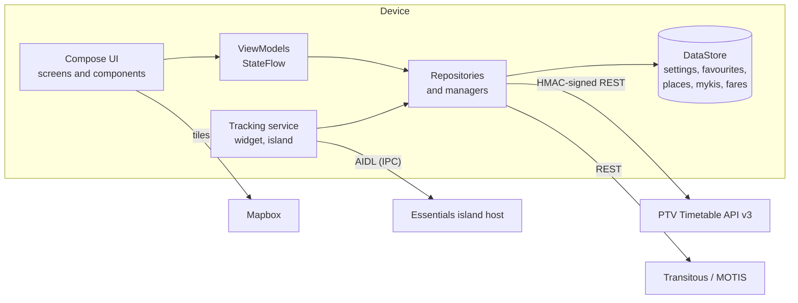

# Architecture

A guided tour of how Journey is put together, for contributors. For setup and keys see the
[README](../README.md), and for how to send changes see [CONTRIBUTING.md](../CONTRIBUTING.md).

## Contents

- [Overview](#overview)
- [Layers](#layers)
- [App start-up and dependency injection](#app-start-up-and-dependency-injection)
- [Navigation](#navigation)
- [State and data flow](#state-and-data-flow)
- [Data sources](#data-sources)
- [Persistence](#persistence)
- [Fares](#fares)
- [myki](#myki)
- [Live vehicle tracking](#live-vehicle-tracking)
- [Tracking notification and widget](#tracking-notification-and-widget)
- [Essentials island provider](#essentials-island-provider)
- [UI system](#ui-system)
- [Testing](#testing)
- [Build notes](#build-notes)

## Overview

Journey is a **single-module, single-activity** Android app written in Kotlin with Jetpack Compose and
Material 3 Expressive. It has no backend: it talks directly to a few public services and keeps everything else
on the device.



## Layers

| Layer | Package (`com.ssethhyy.journey.…`) | Responsibility |
|---|---|---|
| UI | `ui.screens`, `ui.components`, `ui.theme`, `ui.navigation` | Composables, theme, navigation keys |
| State | `*ViewModel` classes next to each screen | Turn repository flows into screen state |
| Domain logic | `data.fare`, `data.model` (`TripProgress`), `data.myki` (`MykiLedger`, `ProfileStats`), `tracking` | Pure Kotlin that's easy to unit test |
| Data | `data.api`, `data.planner`, `data.repository`, `data.location` | Network clients, caches, DataStore repositories |
| Integrations | `island`, `widget`, `tracking` | Essentials island, Glance widget, live notification |

Rule of thumb: **business rules live in plain Kotlin objects** (no Android types), screens only draw state, and
only repositories and clients touch the network or disk.

## App start-up and dependency injection

`JourneyApp` creates an `AppContainer`, a small hand-written container that owns the singletons (settings,
favourites, places, myki and fare repositories, the PTV and planner clients, the tracking and myki managers).
Screens get it with `context.appContainer`, and ViewModels are created with `appViewModel { MyViewModel(it) }`.

There's no DI framework on purpose: the graph is small, and tests can swap pieces by subclassing the app
(`TestJourneyApp` points the clients at a local fake server).

## Navigation

[Navigation 3](https://developer.android.com/guide/navigation/navigation-3) with typed keys
(`ui/navigation/Navigation.kt`). `HomeKey` hosts the three tabs (For You, Plan, Map) in a pager with the floating
navigation bar; every other screen is a key (`StopDetailKey`, `TripKey`, `JourneyDetailKey`, `MykiWalletKey`,
`ProfileKey`, `FaresKey`, …) pushed on the back stack through a `Navigator`. Deep links (a low-balance
notification, the widget, the island's settings gear) are turned into the same keys in `MainActivity`.

## State and data flow

```text
repository Flow  ──►  ViewModel (stateIn → StateFlow)  ──►  collectAsStateWithLifecycle  ──►  composable
        ▲                                                                                        │
        └──────────────────────────── ViewModel functions ◄──────────── events (lambdas) ◄───────┘
```

Loading is modelled with `LoadState` (`Loading` / `Error` / `Success`) so screens render skeletons, errors with a
retry, and stale data when a refresh fails.

## Data sources

### PTV Timetable API v3 (`data.api`)

- Every request is signed: the path and query (plus `devid`) is HMAC-SHA1'd with your API key and appended as
  `signature`. See `PtvSigner`.
- DTOs (`PtvDtos`) are lenient and mappers (`PtvMappers`) turn them into domain models, because the real data is
  messy. Both are covered by tests.
- `PtvRepository` adds short-lived `TtlCache`s so screens don't hammer the API, and fetches fare zones
  (`stop_ticket`) for the fare engine.
- The credentials come from `local.properties` at build time (baked into `BuildConfig`) or from *Settings → API access*,
  which wins when set.

### Journey planner (`data.planner`)

A client for [Transitous](https://transitous.org) (MOTIS `/api/v1/plan` and `/geocode`). Results are mapped to
`Journey` / `JourneyLeg` with decoded polylines. `JourneyRepository` remembers the request each journey came from
so the detail screen can **re-plan** it for live updates.

## Persistence

Everything is stored with Jetpack DataStore (JSON in preferences): settings, favourites, places, mykis and trip
history, and fare edits. Each store has a repository exposing a `Flow`, and the encode/decode and list logic
(`PlacesCodec`, `MykiLedger`, `FareConfigs`) is pure so it can be tested without Android.

## Fares

`data.fare` turns "I went from A to B" into "that costs $X on this myki today".

- **`FareModels.kt`** holds the data: `FareTable` (prices per fare class), `FareRule` (discounts) and
  `VicHolidays`. `FareDefaults` has the app's built-in values (the 2026 prices, the half-price period, free
  travel for under-18s, Seniors weekends, Early Bird).
- **`FareEngine.quote`** is a pure function. For a trip (legs with zones) and the day's earlier trips on that myki
  it applies, in order: the **Free Tram Zone**, the **best discount rule**, the **2-hour window** (a trip inside it
  is covered, a zone upgrade pays only the difference), then the **daily cap** (weekend and public-holiday caps
  included). The myki "day" runs 3 am to 3 am Melbourne time. Prices are rounded down to 5 cents after a discount.
- **Zones** come from PTV's stop data (`StopFare`), resolved by `MykiManager` for the stops of a journey or the ones a
  user picks. The user can override the zone before logging.
- **`FareConfigRepository`** stores only what the user changed: edited prices, switched-off built-in rules and
  custom rules. Built-in rules follow the app's defaults, so updating `FareDefaults` in a new release reaches users.
- After each 1 January the app asks the user to confirm prices (`FareConfigs.needsReview`).

### Updating fares or discounts

1. Edit `FareDefaults.table` / `FareDefaults.rules` / `VicHolidays` in `FareModels.kt`.
2. Add tests in `FareEngineTest` / `MykiFaresTest`, then run `./gradlew :app:testDebugUnitTest`.
3. Link the official source in your PR and add a line to the changelog.

## myki

- **`Myki.kt`** has the models (`MykiCard`, `MykiActivity`, `MykiTripRecord`), card-number rules (15 digits, prefix
  `308425`, Luhn check digit), `MykiLedger` (pure list operations: default card, deductions, top ups, low-balance
  state) and `MykiRepository`.
- **`MykiManager`** is the only thing that changes a balance, so the **low-balance notification** fires whichever
  way the balance moved. It also builds fare trips from journeys and picked stops.
- **`MykiNfc`** reads the card number over NFC (DESFire application `0x11F2`, file `0x0F`). A myki's balance and trips
  are locked on the card and can't be read, so balances are entered by the user and adjusted by logged trips.
- **`ProfileStatsCalculator`** derives the profile page's numbers from logged trips.

## Live vehicle tracking

The trip screen requests a run's stopping pattern with `expand=All`, which includes the vehicle's position.

- `TripProgress.locate` projects the vehicle onto the line through the stops (nearest segment, fraction, "at a stop"
  within about 90 m) and `TripProgress.bestPath` picks the route geopath that fits the stops.
- `TripProgress.window` shortens the stop list around you and the vehicle.
- `TripMap` draws the route, stops and an animated vehicle marker. Positions older than five minutes (or past
  their expiry) are ignored. The pattern refreshes every 10 s, with the route line fetched only once.
- Not every service shares its position, so the screen degrades to timetable and live-prediction times.

## Tracking notification and widget

- `tracking.TrackingManager` polls the service or journey being tracked and exposes a status (title, detail,
  countdown chip, progress). `TrackingService` is a foreground service that posts the live notification
  (`ProgressStyle` on Android 16) and `TrackingUi` shows the in-app banner.
- `widget` is a Jetpack Glance widget with responsive layouts, refreshed by WorkManager and the manual refresh button.

## Essentials island provider

`island.JourneyIslandService` implements the [Essentials Island SDK](../third_party/essentials-island/ISLAND_PROVIDERS.md)
as a provider. `JourneyIsland` builds the payload (compact cells, line, expanded size) within the host's validation
limits, `IslandIcons` renders small bitmaps (including the severity-coloured alert icons), and `IslandExpanded` draws the
expanded cards. The user chooses what is shown in *Settings → Island*. The host allows few peeks, so Journey peeks
only at meaningful moments (`TrackingPeekPolicy`). `IslandHostSimulatorTest` plays the host side of the protocol.

## UI system

- **Theme:** `MaterialExpressiveTheme` with dynamic colour, an optional pitch-black dark theme and expressive
  motion. Mode colours and typography live in `ui.theme`.
- **Icons:** Material Symbols **Rounded** vectors in `res/drawable/rounded_*`, accessed through `Sym`. There are no
  fallbacks to the old icon set. `res/raw/keep.xml` stops release builds stripping them (they're loaded by name).
- **Floating bars:** the bottom navigation bar and the top pill (`ReusableTopAppBar`) float over content that scrolls
  underneath them, with an AGSL progressive blur (`progressiveBlur`, `floatingBarBlur`). The blur is skipped below
  Android 13 or in power-saving mode.
- **Sheets:** `StandardBottomSheet(scrollable = true)` for forms (opens full height, scrolls, lifts above the keyboard).

## Testing

| Layer | Approach |
|---|---|
| Pure logic | JUnit (fares, trip progress, ledger, profile stats, planner and API mapping, signing) |
| Network clients | OkHttp `MockWebServer` and the shared `FakePtvServer` |
| Screens and flows | Robolectric with native graphics and Compose test rules, rendering real screens to PNGs in `app/build/screenshots/` |
| Island | Payload limits (`JourneyIslandModelTest`) and a simulated host (`IslandHostSimulatorTest`) |
| Resources | `SymbolsTest` checks every symbol exists, and that release shrinking keeps them |

No test needs a device, the internet or real keys.

## Build notes

- Dependency versions are in [`gradle/libs.versions.toml`](../gradle/libs.versions.toml). `compileSdk` is 37 with minor API
  level 1 (the island SDK needs it), `minSdk` 26, and the Java toolchain is 25.
- The Essentials island SDK modules are vendored in `third_party/` and included as Gradle projects.
- Release builds use R8 and resource shrinking and are signed with the **debug key** so they install locally. Use a
  real signing config (kept out of Git) to publish.
