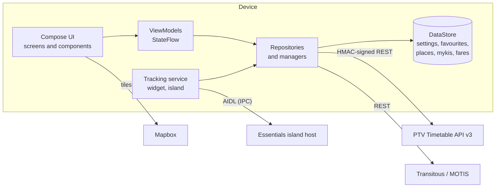

# Architecture

A guided tour of how Journey is put together, for contributors. For setup and keys see the
[README](../README.md), and for how to send changes see [CONTRIBUTING.md](../CONTRIBUTING.md).

## Contents

- [Overview](#overview)
- [Layers](#layers)
- [App start-up and dependency injection](#app-start-up-and-dependency-injection)
- [Navigation](#navigation)
- [State and data flow](#state-and-data-flow)
- [Data sources](#data-sources)
- [Persistence](#persistence)
- [Fares](#fares)
- [myki](#myki)
- [Live vehicle tracking](#live-vehicle-tracking)
- [Journeys on maps](#journeys-on-maps)
- [Favourites, commutes and nearby](#favourites-commutes-and-nearby)
- [Crowding](#crowding)
- [Tracking notification and widget](#tracking-notification-and-widget)
- [Stop alerts](#stop-alerts)
- [In-app updates](#in-app-updates)
- [Essentials island provider](#essentials-island-provider)
- [UI system](#ui-system)
- [Testing](#testing)
- [Build notes](#build-notes)

## Overview

Journey is a **single-module, single-activity** Android app written in Kotlin with Jetpack Compose and
Material 3 Expressive. It has no backend: it talks directly to a few public services and keeps everything else
on the device.



## Layers

| Layer | Package (`com.ssethhyy.journey.…`) | Responsibility |
|---|---|---|
| UI | `ui.screens`, `ui.components`, `ui.theme`, `ui.navigation` | Composables, theme, navigation keys |
| State | `*ViewModel` classes next to each screen | Turn repository flows into screen state |
| Domain logic | `data.fare`, `data.model` (`TripProgress`), `data.myki` (`MykiLedger`, `ProfileStats`), `tracking` | Pure Kotlin that's easy to unit test |
| Data | `data.api`, `data.planner`, `data.repository`, `data.location` | Network clients, caches, DataStore repositories |
| Integrations | `island`, `widget`, `tracking` | Essentials island, Glance widget, live notification |

Rule of thumb: **business rules live in plain Kotlin objects** (no Android types), screens only draw state, and
only repositories and clients touch the network or disk.

## App start-up and dependency injection

`JourneyApp` creates an `AppContainer`, a small hand-written container that owns the singletons (settings,
favourites, places, myki and fare repositories, the PTV and planner clients, the tracking and myki managers).
Screens get it with `context.appContainer`, and ViewModels are created with `appViewModel { MyViewModel(it) }`.

There's no DI framework on purpose: the graph is small, and tests can swap pieces by subclassing the app
(`TestJourneyApp` points the clients at a local fake server).

## Navigation

[Navigation 3](https://developer.android.com/guide/navigation/navigation-3) with typed keys
(`ui/navigation/Navigation.kt`). `HomeKey` hosts the three tabs (For You, Plan, Map) in a pager with the floating
navigation bar; every other screen is a key (`StopDetailKey`, `TripKey`, `JourneyDetailKey`, `MykiWalletKey`,
`ProfileKey`, `FaresKey`, …) pushed on the back stack through a `Navigator`. Deep links (a low-balance
notification, the widget, the island's settings gear) are turned into the same keys in `MainActivity`.

## State and data flow

```text
repository Flow  ──►  ViewModel (stateIn → StateFlow)  ──►  collectAsStateWithLifecycle  ──►  composable
        ▲                                                                                        │
        └──────────────────────────── ViewModel functions ◄──────────── events (lambdas) ◄───────┘
```

Loading is modelled with `LoadState` (`Loading` / `Error` / `Success`) so screens render skeletons, errors with a
retry, and stale data when a refresh fails.

## Data sources

### PTV Timetable API v3 (`data.api`)

- Every request is signed: the path and query (plus `devid`) is HMAC-SHA1'd with your API key and appended as
  `signature`. See `PtvSigner`.
- DTOs (`PtvDtos`) are lenient and mappers (`PtvMappers`) turn them into domain models, because the real data is
  messy. Both are covered by tests.
- `PtvRepository` adds short-lived `TtlCache`s so screens don't hammer the API, and fetches fare zones
  (`stop_ticket`) for the fare engine.
- The credentials come from `.env` at build time (baked into `BuildConfig`) or from *Settings → API access*,
  which wins when set.

### Journey planner (`data.planner`)

A client for [Transitous](https://transitous.org) (MOTIS `/api/v1/plan` and `/geocode`). Results are mapped to
`Journey` / `JourneyLeg` with decoded polylines. `JourneyRepository` remembers the request each journey came from
so the detail screen can **re-plan** it for live updates.

Place search is limited by `SearchRegion` (Victoria by default, or Australia, chosen in *Settings → Map*): results
are ranked from the user's location or Melbourne, and dropped unless they fall inside the region's box **and** the
state or country the geocoder reports matches. The Map tab's camera is bounded to the same box.

### Transport Victoria Open Data (`data.crowding`)

Optional GTFS Realtime vehicle-position feeds, read with a free key in the `KeyID` header and parsed by a small
hand-written protobuf reader (`GtfsRealtime`). See [Crowding](#crowding).

### Weather (`data.weather`)

`WeatherApi` asks one of three providers for current conditions in metric units: OpenWeatherMap (`/data/2.5/weather`,
the default), WeatherAPI.com (`/v1/forecast.json`, for today's high and low too) or Open-Meteo (`/v1/forecast`, no
key). `WeatherParsers` maps each response, and each provider's condition codes, to one `WeatherNow`.
`WeatherRepository` picks the key (the user's own for that provider, else, for the default provider only, the
`WEATHER_KEY` built from `.env`), uses the last known location or Melbourne, and caches a reading for 15 minutes.

### GitHub Releases (`data.update`)

The public GitHub API, read without a key, for the in-app updater. See [In-app updates](#in-app-updates).

## Persistence

Everything is stored with Jetpack DataStore (JSON in preferences): settings, favourites, places, mykis and trip
history, and fare edits. Each store has a repository exposing a `Flow`, and the encode/decode and list logic
(`PlacesCodec`, `MykiLedger`, `FareConfigs`) is pure so it can be tested without Android.

## Fares

`data.fare` turns "I went from A to B" into "that costs $X on this myki today".

- **`FareModels.kt`** holds the data: `FareTable` (prices per fare class), `FareRule` (discounts) and
  `VicHolidays`. `FareDefaults` has the app's built-in values (the 2026 prices, the half-price period, free
  travel for under-18s, Seniors weekends, Early Bird).
- **`FareEngine.quote`** is a pure function. For a trip (legs with zones) and the day's earlier trips on that myki
  it applies, in order: the **Free Tram Zone**, the **best discount rule**, the **2-hour window** (a trip inside it
  is covered, a zone upgrade pays only the difference), then the **daily cap** (weekend and public-holiday caps
  included). The myki "day" runs 3 am to 3 am Melbourne time. Prices are rounded down to 5 cents after a discount.
- **Zones** come from PTV's stop data (`StopFare`), resolved by `MykiManager` for the stops of a journey or the ones a
  user picks. The user can override the zone before logging.
- **`FareConfigRepository`** stores only what the user changed: edited prices, switched-off built-in rules and
  custom rules. Built-in rules follow the app's defaults, so updating `FareDefaults` in a new release reaches users.
- After each 1 January the app asks the user to confirm prices (`FareConfigs.needsReview`).

### Updating fares or discounts

1. Edit `FareDefaults.table` / `FareDefaults.rules` / `VicHolidays` in `FareModels.kt`.
2. Add tests in `FareEngineTest` / `MykiFaresTest`, then run `./gradlew :app:testDebugUnitTest`.
3. Link the official source in your PR and add a line to the changelog.

## myki

- **`Myki.kt`** has the models (`MykiCard`, `MykiActivity`, `MykiTripRecord`), card-number rules (15 digits, prefix
  `308425`, Luhn check digit), `MykiLedger` (pure list operations: default card, deductions, top ups, low-balance
  state) and `MykiRepository`.
- **`MykiManager`** is the only thing that changes a balance, so the **low-balance notification** fires whichever
  way the balance moved. It also builds fare trips from journeys and picked stops.
- **`MykiNfc`** reads the card number over NFC (DESFire application `0x11F2`, file `0x0F`). A myki's balance and trips
  are locked on the card and can't be read, so balances are entered by the user and adjusted by logged trips.
- **`ProfileStatsCalculator`** derives the profile page's numbers from logged trips.

## Live vehicle tracking

The trip screen requests a run's stopping pattern with `expand=All`, which includes the vehicle's position.

- `TripProgress.locate` projects the vehicle onto the line through the stops (nearest segment, fraction, "at a stop"
  within about 90 m) and `TripProgress.bestPath` picks the route geopath that fits the stops.
- `TripProgress.window` shortens the stop list around you and the vehicle.
- `TripMap` draws the route, stops and an animated vehicle marker. Positions older than five minutes (or past
  their expiry) are ignored. The pattern refreshes every 10 s, with the route line fetched only once.
- Not every service shares its position, so the screen degrades to timetable and live-prediction times.

## Journeys on maps

`JourneyMapLayers` draws a planned journey the same way everywhere: one polyline per leg in its PTV mode colour
(walking white), each joined to the previous leg's end, a ringed dot at every change (`JourneyGeometry.changePoints`),
and start and end markers. All of it uses annotation groups with **emissive strength 1** so Mapbox Standard's night
lighting doesn't darken the colours.

- The journey page's map is fixed (gestures off) and opens the full view when tapped.
- `Navigator.showJourneyOnMap` hands a `JourneyMapRequest` to the Map tab, which draws the route over the main map
  and shows `JourneyMapPanel`. Choosing a leg fits the camera to it, using padding for the panels at the top and
  bottom (never leaving less than a third of the screen).
- Planner stops don't carry PTV stop ids, so `PtvRepository.findStop` (in `StopFinder`) matches the name and position
  against nearby PTV stops to open a stop page from a leg.
- Every map outside the Map tab is created with a `TextureView`: a `SurfaceView` can't be drawn through the app-wide
  edge blur.

## Favourites, commutes and nearby

- A `FavouriteStop` may carry `lines` (route and optional direction). Empty means every departure, as before. The
  star button calls `AppContainer.toggleFavourite`, which removes a favourite or opens `FavouritePickerHost` (drawn at
  the app root) to choose lines; `FavouriteChoices` builds the options from the stop's departures.
- `data.commute` learns commutes from planned trips (`CommuteLogic`: two separate occasions make a commute, with the
  usual hour when trips agree) and stores the user's own. `CommutesViewModel` plans each for "leave now" and picks a
  backup after the main trip.
- *Near you* on For You shares the Map tab's `NearbyViewModel`, so the location is looked up once.

## For You widgets

- `ForYouLayout` (in `data.foryou`) holds the widget order, which widgets are collapsed, whether titles show, and each
  widget's config. `ForYouRepository` stores it as one JSON document in its own DataStore; a document that can't be
  read falls back to the default. The first layout is written from the old settings, so Near you stays off for people
  who had turned it off. Settings other screens share (the name, departures per stop, nearby count) stay in
  `AppSettings`.
- `FavouritesScreen` renders `layout.widgets` in order into one `LazyColumn`. Widgets that already spanned several
  list items (Favourites, Commutes, Near you) add their own items, with a `WidgetTitle` first when titles are on.
- `ForYouEditor` is edit mode. The drag is read on the whole list at the initial pointer pass, so it survives the
  dragged item moving and stops the list scrolling: the handle starts it at once, anywhere else after a long press.
  The lifted tile is drawn over the list at the finger; its slot in the list becomes a filled placeholder of the same
  size, and it swaps with a neighbour once its middle passes the neighbour's (from the lazy layout's own offsets, which
  don't move with animations). The list scrolls by itself near its edges. The order is saved once, on release.
- `ForYouDisruptions.select` picks what the Disruptions widget shows: by default current major disruptions (severe or
  major types, or titles that mention closures, replacement buses, suspensions or timetable changes) on the routes of
  favourite stops (only the chosen lines for a favourite limited to some) or naming a favourite stop.
- `ForYouHeader` is the Greeting widget, drawn from `for-you-page-top`: the temperature is Google Sans Flex at weight
  220, width 40 and optical size 144 (`FlexType.single`, sized by `WeatherSize`), and one animated value shrinks it
  into the collapsed bar. The bar centres the time between
  two equal-weight halves. A `NestedScrollConnection` on the list collapses the header after 24 dp of scrolling down
  and expands it on scrolling up while it's on screen, including a pull at the top of the list.

## Crowding

`CrowdingRepository` caches each feed for 30 s and matches the run's vehicle (PTV's carriage numbers or fleet number)
to the feed's vehicle or carriage ids, falling back to the nearest vehicle within 250 m. `CrowdingAlertPolicy`
decides when a tracked service has become busy enough to notify (once, and again only if it gets worse).
`AirConditioningCheck` reports what the fleet data and service alerts say; PTV publishes no live air conditioning
status.

## Tracking notification and widget

- `tracking.TrackingManager` polls the service or journey being tracked and exposes a status (title, detail,
  countdown chip, progress). `TrackingService` is a foreground service that posts the live notification
  (`ProgressStyle` on Android 16) and `TrackingUi` shows the in-app banner.
- `widget` is a Jetpack Glance widget with responsive layouts, refreshed by WorkManager and the manual refresh button.

## Stop alerts

While a journey is tracked, `TrackingService` asks `StopAlertLogic.due` every loop whether a ride is about to end:
within 100 s (trains) or 70 s (trams and buses) of arriving, or within a set distance of the stop by the phone's
location, once per ride. The service declares the `location` foreground type for journeys so it can read the location
in the background. `StopAlertNotifier` posts a silent high-priority notification with a full-screen intent
(`StopAlertActivity`, shown over the lock screen) and vibrates only if the setting is on and the ringer isn't silent
(`StopAlertVibration`). It never plays a sound.

## In-app updates

`UpdateManager.checkOnOpen` runs from `MainActivity.onStart` when enabled, at most every four hours, and asks
`GitHubReleasesApi` for the repository's releases. `UpdateLogic.newest` compares versions semver-style (a pre-release
sorts below its release) and returns the newest release with an `.apk` asset, skipping drafts and, unless asked,
pre-releases. A new version is notified once. `UpdateSheetHost` shows the notes through `MarkdownText`; installing
downloads the APK into the cache with progress and streams it into a `PackageInstaller` session, whose result
(`InstallResultReceiver`) launches Android's confirmation. `REQUEST_INSTALL_PACKAGES` is declared, and the user grants
"install unknown apps" once.

## Essentials island provider

`island.JourneyIslandService` implements the [Essentials Island SDK](../third_party/essentials-island/ISLAND_PROVIDERS.md)
as a provider. `JourneyIsland` builds the payload (compact cells, line, expanded size) within the host's validation
limits, `IslandIcons` renders small bitmaps (including the severity-coloured alert icons), and `IslandExpanded` draws the
expanded cards. The user chooses what is shown in *Settings → Island*. The host allows few peeks, so Journey peeks
only at meaningful moments (`TrackingPeekPolicy`). `IslandHostSimulatorTest` plays the host side of the protocol.

## UI system

- **Theme:** `MaterialExpressiveTheme` with dynamic colour, an optional pitch-black dark theme and expressive
  motion. Mode colours and typography live in `ui.theme`.
- **Icons:** Material Symbols **Rounded** vectors in `res/drawable/rounded_*`, accessed through `Sym`. There are no
  fallbacks to the old icon set. `res/raw/keep.xml` stops release builds stripping them (they're loaded by name).
- **Navigation bar styles** (`BarStyle`, chosen in *Settings → Appearance*):
  - **Bottom bar (default).** One floating toolbar (`JourneyFloatingToolbar`) is drawn above the whole navigation
    stack by `AppChromeHost`. Screens don't draw it: they *register* what it should show with `RegisterChrome`
    (`ChromeSpec.Tabs` from the home screen, `ChromeSpec.Page` from `ReusableTopAppBar`), and the newest
    registration wins. A page appearing on top takes over and the tabs return when it leaves, with the bar morphing
    between the two. Pages give it a title, a back action, an optional main action (`pageFab`) and small icon actions.
  - **Top pill (classic).** `ReusableTopAppBar` draws a floating title pill at the top of each page, and the toolbar
    shows only on the three tabs. This is the original code path and is kept intact.
  - Either way content scrolls under the bars with an AGSL progressive blur (`progressiveBlur`), skipped below
    Android 13 or in power-saving mode. In the bottom bar style one `appEdgeBlur` around the whole navigation stack
    blurs the status bar area and the area behind the bar (fading out while the bar is hidden); in the top pill style
    each page uses `floatingBarBlur`.
- **Type:** `buildTypography` sets Google Sans Flex's optical size, width, weight, slant and roundness (always fully
  rounded) per role, including Material 3 Expressive's emphasized styles. The widget draws with the same font.
- **Sheets:** `StandardBottomSheet(scrollable = true)` for forms (opens full height, scrolls, lifts above the keyboard).

## Testing

| Layer | Approach |
|---|---|
| Pure logic | JUnit (fares, trip progress, ledger, profile stats, planner and API mapping, signing) |
| Network clients | OkHttp `MockWebServer` and the shared `FakePtvServer` |
| Screens and flows | Robolectric with native graphics and Compose test rules, rendering real screens to PNGs in `app/build/screenshots/` |
| Island | Payload limits (`JourneyIslandModelTest`) and a simulated host (`IslandHostSimulatorTest`) |
| Resources | `SymbolsTest` checks every symbol exists, and that release shrinking keeps them |

No test needs a device, the internet or real keys.

## Build notes

- Dependency versions are in [`gradle/libs.versions.toml`](../gradle/libs.versions.toml). `compileSdk` is 37 with minor API
  level 1 (the island SDK needs it), `minSdk` 26, and the Java toolchain is 25.
- The Essentials island SDK modules are vendored in `third_party/` and included as Gradle projects.
- Keys and signing come from `.env` (see `.env.template`), then environment variables, then the old
  `local.properties` names. `app/build.gradle.kts` turns them into `BuildConfig` fields, a resource value for the
  Mapbox token and a `release` signing config.
- Release builds use R8 and resource shrinking. They're signed with the release keystore from `.env`, or with the
  debug key when none is set. Debug builds use the `.dev` application id suffix.
